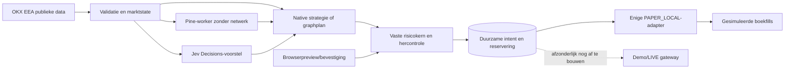

# Architectuur en besluiten · 0.4.0 · 2026-10-02

## ADR-001: nieuw en uitsluitend lokaal

BUILD_SPEC.md bewaart de volledige productscope. De actuele opdracht om lokaal te bouwen gaat voor de VPS-optie in die tekst. Checkout, secrets, backups en datasets staan buiten iCloud. Geen oude tradingcode, configuraties of keys gebruikt. Zie STATUS.md voor de feitelijke releasegrens; Demo/LIVE is niet af.

## ADR-002: kleine uitvoeringskern

Eén Rust/Tokio/Axum-app bevat publieke marktdata, incrementele indicatorberekening, vaste Decimal-risk/OMS, botloop en control-API. PostgreSQL bewaart rekening, reserveringen, orders/fills, versies, audit, providers en alerts. Immutable Snappy-Parquet staat in een apart volume. Geen Redis, broker, ClickHouse of Timescale zonder gemeten behoefte.

De browser levert voorstellen/bediening, geen autoriteit. De rekeningrij wordt voor mutaties gelockt; intent, reserve en audit worden vóór verwerking vastgelegd. De lokale paperadapter heeft geen netwerkorderfunctie. Een sessie-advisorylock laat één paperworker per database toe. Een tweede proces mag niet simuleren. Dit is nog geen live-fencing over onafhankelijke databases/hosts.

## ADR-003: gegevenskwaliteit

`books` gebruikt snapshots plus Decimal-delta’s met seqId/prevSeqId, heartbeat/resetregels en resync na een gat. Geen checksum of gemengd REST-boek. Top vijf niveaus worden naar de UI gepubliceerd; reconstructie bewaart maximaal het kanaalbereik. Tickers/trades/candles zijn echte OKX-data. Reconnect wist onbetrouwbare actuele caches. Catalogus elke vijf minuten; klokcontrole periodiek. Nieuwe exposure vereist verse prijs/metadata, geldige klok en duurzame opslag.

Candles komen nu via REST, maximaal 300 per pagina, met gedeelde mutex en tien seconden cache. Hogere tijdframes gebruiken OKX-bars; nog geen business-WS-candlepipeline. Gaten blijven expliciet. Open bars krijgen alleen voorlopige chartberekeningen; bots/Pine/replay gebruiken gesloten bars. Native indicatorstate verwerkt iedere bar incrementeel; een REST-refresh herbouwt de begrensde reeks. Geld en sizing blijven Decimal, chartanalyse gebruikt f64.

## ADR-004: geïsoleerde Pine

PineTS 0.11.0 achter een vervangbare adapter. Werkelijke parser/AST en een expliciet capabilityprofiel, geen regex-transpiler. Monaco is lazy loaded zodat de editor niet in de eerste terminalbundel zit. Workercontainer: geen netwerk, secrets, DB of hostfiles, non-root, read-only root, 256 MB/0,5 CPU/32 pids. Elke job een nieuw Node-proces met permission model, drie seconden deadline en begrensde uitvoer. Alleen de jobvolumegrens is gedeeld. Backend één script tegelijk, vijf seconden einddeadline. Geldberekening en uitvoeringsautoriteit zitten nooit in Pine.

## ADR-005: Jev en langzame bronnen

Jev draait als begrensde asynchrone provideradapter binnen het Rust-proces. Het model ontvangt compacte markt-/indicatorstate, geen credentials, geen uitvoerbare tools en geen gebruikersidentiteit. Een aparte Jev-container is niet toegevoegd: de paperbinary heeft sowieso geen exchange-secret of private module. Voor een toekomstige echte gateway blijft procesisolatie van exchangecredentials verplicht.

News/Fear & Greed werken in eigen langzame serverloops. Alleen vaste providerhosts; nieuws is onbetrouwbare tekst. Jev gebruikt Decisions API en gepinde model-id, kostencaps/reservering, deadline, confidence/schema/TTL/statechecks en circuit-breaker. Iedere AI-afhankelijke intent passeert opnieuw de vaste risicokern.

## ADR-006: runtime en herstel

De terminal wordt statisch met Rust/musl gebouwd en draait op gepinde Alpine, zonder compiler/Node/npm/curl in de runtime. Pine draait op gepinde Node/Alpine zonder ongebruikte npm/yarn. PostgreSQL 18.6 start als postgres; ongebruikte gosu is uit de image verwijderd. Exacte basisdigests staan in Dockerfiles. Runtimebeveiliging en scanbewijs staan in THREAT_MODEL.md/evidence.

Een herstart herlaadt duurzame paperstate, versies en kostentellers, zonder rekening- of verliesreset. UNKNOWN blijft gereserveerd. Nieuwe entries blijven dicht bij onbetrouwbare data/opslag. Opslagmeting elke 30 s: >=95% of onbekend pauzeert entries tot expliciet hervatten. Lokale bescherming vereist een draaiende Mac/Docker en verse koersen.

AES-GCM-backup bevat PostgreSQL-dump en immutable Parquet, met aparte lokale sleutel. Restoretest gebruikt nieuwe tijdelijke database/volume en controleert integriteit. Browser-local tekeningen zitten niet in deze serverbackup. Demo-onboarding is een afzonderlijke binary met uitsluitend read-only accountdetectie; volledige private sync/native bescherming/ordergateway ontbreken nog.
