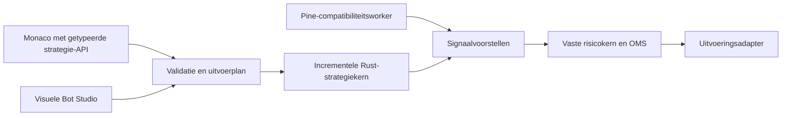

# Pine-compatibiliteit, editor en alternatieven

Onderzocht op **5 oktober 2026**, circa 09:40–10:00 Europe/Amsterdam. Project: lokale OKX Tradingterminal, release-aanduiding 0.4.0. Dit is een onderzoeksrapport, geen uitgevoerde reparatie of handelsvrijgave.

## Oordeel

**Bruikbaar als begrensde indicatorproeftuin. Nog onvoldoende als betrouwbare algemene Pine-strategieomgeving. Voor livehandel niet gereed.**

De lokale laag is een eigen integratie rond **PineTS 0.11.0**, met een echte parser/runtime en een zelfgebouwde broker, beveiligingsgrenzen, signaalvertaling en editor. Het is geen zelfgeschreven volledige Pine-implementatie en ook geen officiële TradingView-runtime. Dat is een redelijke basis, maar correcte uitvoering van enkele voorbeelden bewijst geen brede compatibiliteit.

Mijn voorkeursrichting voor nieuwe strategieën is **een compacte, getypeerde strategie-API die een gecontroleerd uitvoerplan oplevert, uitgevoerd door een incrementele Rust-kern**. Behoud Pine als afzonderlijke compatibiliteitsroute. Monaco, Bot Studio, marktdata en de vaste risicokern zijn bruikbare onderdelen om op voort te bouwen. Een volledig nieuwe algemene programmeertaal of totale terminalherschrijving is daarvoor niet nodig.

## Wat daadwerkelijk is gecontroleerd

- Broncode van worker, broker, Pine Editor, Bot Studio-uitvoering, replay en indicatorberekening; compatibiliteitsmatrix en bestaande acceptatieverslagen.
- Draaiende terminal op `http://127.0.0.1:4780`, Pine-worker en editor. De standaardpreview slaagde op 299 echte gesloten BTC-EUR-candles van 15 minuten.
- De **11 bestaande Pine-fixtures opnieuw uitgevoerd: allemaal geslaagd**.
- **29 aanvullende synthetische worker-runs**: 19 gerichte functie-/randgevallen en 10 tijdmetingen. Dit is geen uitspraak dat 29 compatibiliteitstests zijn geslaagd: meerdere probes tonen tekortkomingen.
- Vijf actuele HTTP-previewmetingen, plus editorproeven voor numerieke opties en conceptbehoud.
- Officiële documentatie van TradingView, PineTS/LuxAlgo, Monaco, Rhai, Wasmtime, VectorBT en NautilusTrader.

Geen productiebroncode aangepast, geen rekening of bot aangemaakt, geen backtestorders op de gebruikersrekening en geen Demo-/LIVE-orders. De volledige risk-/replay-integratiesuite is niet opnieuw uitgevoerd. De replaybeoordeling steunt op broncode, workerproeven en expliciet als historisch aangemerkt acceptatiebewijs. Willems eigen verzameling scripts is niet aangeleverd of getest. Er is geen vergelijking met een TradingView-export op identieke candles uitgevoerd.

De workerbestanden in de draaiende container komen qua SHA-256 overeen met de onderzochte lokale broncode:

- `run.mjs`: `8b5d3ef9f3b30028f127f50126677eddaa689ec18ef51eb6e3b405c7a52f5020`
- `broker.mjs`: `d7cec46c89d7d14b37b63e14d6329a675dd76df3c7b06f7a86131fb6dae8c7c2`

Er waren al niet-gecommitte wijzigingen in het project. Dit rapport beoordeelt de aangetroffen bestanden en runtime, niet alleen een Git-release. Tijdens de inspectie veranderde de algemene terminalopmaak; bovenstaande workerhashes en concrete reproducties begrenzen het bewijs.

## Bruikbaarheid per doel

| Doel | Oordeel | Praktische grens |
|---|---|---|
| Eenvoudige SMA/EMA/RSI-indicator schrijven en bekijken | Ja, als experiment | Gesloten candles, beperkte historie, parameters en uitkomsten zelf controleren |
| Een willekeurig TradingView-script importeren | Nee als algemene belofte | Veel gangbare capabilities bewust uitgeschakeld; andere werken onvolledig |
| Candle-backtests met eenvoudige entry/exit-signalen | Onderzoeksbasis | Geen TradingView-strategypariteit; hieronder staan verschillen die uitkomsten beïnvloeden |
| Zelfstandig draaiende Pine-paperbot | Alleen geselecteerde, afzonderlijk gevalideerde scripts | Eerst historie/state, timeframe en uitvoercontract repareren |
| OKX Demo of echt geld | Nee | Los van Pine ontbreekt nog volledige geaccepteerde exchange-uitvoering |

## Wat goed is

- Pine v5/v6-bron gaat door een echte PineTS-parser; geen regex-vertaling naar een andere programmeertaal.
- Basisberekeningen, history en `var` binnen één run werken in de bestaande fixtures. Aanvullend werken eenvoudige EMA/RSI/ATR-berekeningen, een eigen functie en een arrayvoorbeeld.
- Er zijn inputs met validatie, opgeslagen onveranderlijke versies, import/export en foutmarkeringen na uitvoering.
- Strategievoorstellen zijn gescheiden van risicotoestemming en orderuitvoering. `entry`/`exit` zijn voorstellen, geen directe orders.
- Worker: aparte netwerkloze container, zonder credentials/database, read-only bestandssysteem, proces-/geheugenlimieten en deadline. Dat is een zinvolle verdedigingslaag; deze review is geen volledige sandboxpenetratietest.
- Maand- en kwartaalcandles worden voor Pine expliciet geweigerd. Dat is duidelijker dan doen alsof een vaste tijdsduur dezelfde betekenis heeft.

## Concrete bevindingen en prioriteit

### 1. Hoog: geheugen en historie verschillen tussen paper en replay

`backend/src/studio.rs:65` vraagt actuele candles op; `backend/src/main.rs` begrenst die aanvraag op 300. `pine-worker/run.mjs:18` maakt bij iedere run een nieuwe PineTS-instantie. De broker start daarbij opnieuw een Node-proces. Er blijft dus geen scriptgeheugen over tussen opeenvolgende aanvragen.

Reproductie: een `var`-teller eindigt op 600 bij 600 bars, maar op 300 bij de laatste 300 bars van dezelfde reeks. Een signaal `count > 350` levert in de lange run 250 voorstellen op en in het korte venster nul. Een paperbot die telkens een venster van circa 300 bars opnieuw doorloopt, bereikt die grens nooit. Ook cumulatieve indicatoren, langetermijnstate en de initialisatie van recursieve gemiddelden kunnen verschillen.

Dat Pine vanaf het begin van een aangeleverde dataset rekent is op zichzelf niet fout. **De integratiefout is dat backtest en doorlopende bot verschillende initialisatiegeschiedenis gebruiken, terwijl dezelfde strategie-uitkomst wordt verondersteld.** Dezelfde runtime gebruiken is niet voldoende om dezelfde strategiebetekenis te garanderen.

Benodigd: expliciet warm-upcontract, blijvende state per scriptversie/instrument/timeframe, herstel na herstart en vergelijking van batchuitvoering met bar-voor-bar-uitvoering.

### 2. Hoog: een 21e plot kan een exit of entry stil verwijderen

In `pine-worker/run.mjs:35` worden de eerste twintig plots geselecteerd; pas daarna worden daaruit handelssignalen gehaald. Reproductie: twintig gewone plots gevolgd door `plot(1,"entry")` geeft `ok: true`, geen diagnostiek en **nul** voorstellen. Een exit kan op dezelfde manier verdwijnen.

Benodigd: signaaluitvoer onafhankelijk maken van weergavelimieten. Te veel plots expliciet afwijzen of waarschuwen; nooit onzichtbaar handelslogica afkappen.

### 3. Hoog: deployment gebruikt vast één minuut

`backend/src/graph.rs:245` voert een Pine-node uit met hardgecodeerd `"1m"`. De editor gebruikt het gekozen chartinterval, bijvoorbeeld 15 minuten. De opgeslagen Pine-versie bevat bron/inputs/profiel, maar geen bindend timeframecontract. Hetzelfde script kan daardoor bij deployment op een andere tijdschaal draaien dan waarop het is bekeken of getest.

Benodigd: instrument, interval, warm-up en databron als expliciete deploymentmetadata vastleggen en in editor/backtest/bot identiek toepassen.

### 4. Middel: numerieke keuzelijsten werken na wijzigen niet

Browserreproductie met `input.int(3,"Periode",options=[3,5,10])`: de eerste preview werkt. Selecteer 5 en voer opnieuw uit: **Input buiten bereik: Periode**. De editor zet iedere keuzewaarde om in tekst (`frontend/src/Studio.tsx:328`), terwijl de worker voor `int` een getal vereist. Na de fout verdwijnen bovendien de inputformulieren uit het resultaat.

Benodigd: keuzewaarden op hun gedeclareerde type verwerken en parameterformulieren onafhankelijk van een geslaagde runtime-uitvoer bewaren.

### 5. Middel: onopgeslagen code verdwijnt bij navigatie

Een eigen tijdelijk proefscript ingevoerd, naar Terminal gegaan en terug naar Pine Editor. Zonder waarschuwing stond het standaardvoorbeeld er weer. De bron is componentstate (`frontend/src/Studio.tsx:89`); navigatie ontkoppelt die component.

Benodigd: lokaal conceptherstel, meerdere stabiele documentmodellen, een gewijzigd-indicator en bescherming tegen onbedoeld verlies. Ook resultaten moeten zichtbaar als verouderd worden gemarkeerd zodra bron of inputs veranderen. Nu blijft na bronwijziging de vorige melding “Berekening geslaagd” bij oude grafieken staan.

### 6. Middel: onvoldoende gevalideerde contextvariabelen

De extra workerproef voor `syminfo.mintick` en `syminfo.pointvalue` gaf uitsluitend null-waarden zonder diagnostiek. De terminal kent de OKX-tickgrootte wel, maar deze instrumentmetadata wordt niet volledig aan het script aangeleverd.

Een volledig historische synthetische dataset uit 2023 gaf bovendien `barstate.isrealtime = true` op de laatste bar. Daardoor is historische berekening niet vanzelf gelijk aan de door Pine bedoelde historische context. Deze proef bewijst een profieltekort, geen exploit of volledige uitspraak over alle PineTS-contextfuncties.

Benodigd: metadata-adapter en expliciete historische/realtime-context; onbekende contextfuncties afwijzen zolang correct gedrag niet bewezen is. TradingView documenteert het onderscheid tussen historical, realtime en confirmed apart: [bar states](https://www.tradingview.com/pine-script-docs/concepts/bar-states/).

### 7. Functionele dekking blijft beperkt

- Geblokkeerd: `strategy.*`, de volledige `request`-namespace inclusief `request.security`, imports/exports en `varip`.
- Geen gevalideerde intrabar-updates of rollback.
- Geen volledige weergave van Pine-lines, labels, boxes, tables, fills, kleuren, stijlen, offsets of aparte indicatorpanelen op de hoofdchart. De editor toont eenvoudige afzonderlijke lijngrafiekjes. Offsets worden niet behouden in de teruggegeven plotmetadata.
- `alertcondition()` werd geaccepteerd, maar de worker geeft geen Pine-alertuitvoer door aan de terminal. De gewone serveralerts in het product zijn een afzonderlijke functie.
- Pine-preview circa 300 candles; replay maximaal 5.000. Op één minuut is dat ongeveer 3,5 dagen. Een langere geimporteerde dataset wordt teruggebracht tot de laatste 5.000.
- De Pine-backtestknop gebruikt vaste UI-aannames voor kapitaal/order/stop/target/kosten. Er is daar geen complete configuratie of datumselectie. Alleen EUR-symbolen zijn via die knop beschikbaar.
- Limieten: 12 KB bron, 40 inputs, twintig zichtbare reeksen, 3 seconden workerdeadline, 128 MB Node-heap en 1 MB uitvoer. De combinatie van veel plots en 5.000 bars kan eerder op het uitvoerbudget stuiten.

Upstream PineTS biedt meer, waaronder strategie-, MTF- en streamingfuncties. Die worden door deze terminal nog niet aangeboden of gevalideerd. Een dependency-update alleen lost de lokale integratieproblemen niet op. Zie [PineTS](https://github.com/LuxAlgo/PineTS) en [coverage](https://docs.luxalgo.com/developers/pinets/api-coverage). Volledige Pine-semantiek omvat ook uitvoerings- en brokerregels: [execution model](https://www.tradingview.com/pine-script-docs/language/execution-model/) en [strategies](https://www.tradingview.com/pine-script-docs/concepts/strategies/).

### 8. De editor is een bruikbare basis, nog geen volledige IDE

Monaco is een goede keuze. De huidige Pine-integratie biedt basale kleuring en slechts zeven vaste suggesties. Er is geen contextgevoelige Pine-typeservice, signature help, betrouwbare symbolennavigatie, profiler of debugger. Diagnostiek komt pas na Preview; sommige fouten vallen terug op regel 1. Bewaren vereist geen geslaagde compilatie. Dat laatste kan nuttig zijn voor concepten, maar deployment vereist dan een aparte acceptatiestatus.

De grafiekjes gebruiken geen bruikbare tijd-/prijsassen en verbinden niet-null-punten over ontbrekende waarden. Uitgebreid visueel vergelijken met koers en fills ontbreekt. De aangetroffen layout is bruikbaar voor eenvoudige invoer en inspectie, niet voor intensieve strategieontwikkeling.

## Snelheid: meting versus verwachting

SMA 9/21 met twee signaalplots; bestaande container met **0,5 CPU**. Vijf metingen per rij. Andere lokale toepassingen bleven draaien; geen gestandaardiseerde labbenchmark.

| Scenario | Mediaan | Bereik |
|---|---:|---:|
| 300 synthetische bars, door worker gerapporteerde duur | 163 ms | 103–189 ms |
| Dezelfde run inclusief starten Node-kindproces | 285 ms | 217–388 ms |
| 5.000 synthetische bars, door worker gerapporteerde duur | 470 ms | 404–775 ms |
| Dezelfde run inclusief starten Node-kindproces | 687 ms | 611–1.015 ms |
| Volledige lokale HTTP-preview, 299 echte 15m-bars | 407 ms | 246–574 ms |

De interne timer begint na het laden van runtimecode. Het getal in de editor is dus niet de volledige wachttijd. De workerproeven omvatten geen brokerpolling, API of dataverwerving; de laatste rij wel. Vijf metingen onderbouwen geen betrouwbare p95/p99 of hoge-concurrentieclaim.

Voor handmatige previews is dit snel genoeg. De huidige architectuur is minder geschikt voor veel scripts of tickuitvoering: iedere run een nieuw proces, opnieuw parsen/rekenen, JSON-bestandsuitwisseling, polling op 100/75 ms en één globale gelijktijdige Pine-run. Een bezette runtime geeft een afwijzing in plaats van een geplande wachtrij. Er is hier **geen benchmark die aantoont hoeveel sneller Rust, WASM of een nieuwe taal zou zijn**, en geen vergelijking met de TradingView-cloudruntime.

## Alternatieven

| Optie | Sterkte | Kosten/beperking | Advies |
|---|---|---|---|
| PineTS verder afmaken | Bestaande Pine-bron bruikbaar houden; veel upstreamfuncties bestaan | Grote blijvende taak om gedrag, data, orders en tekeningen te laten overeenkomen | Behouden als compatibiliteitsroute; eerst profiel repareren |
| TypeScript-strategie-API in een blijvende geïsoleerde worker | Bekende taal, sterke editorondersteuning, snelle ontwikkelcyclus | Veiligheid, geheugen en eventgedrag moeten expliciet ontworpen; TypeScript zelf maakt JS niet sneller | Goede pragmatische tussenstap als vrije code belangrijk is |
| Beperkte TypeScript-achtige declaraties → uitvoerplan → Rust | Expliciete betekenis, gedeelde indicatoren, incrementele verwerking, aansluiting op bestaande graph/riskkern | Compiler/validatie en strikte beperkingen nodig; niet alle TypeScript of Pine vertaalbaar | **Beste basis voor nieuwe terminalstrategieën binnen begrensde scope** |
| Rust-strategieën als WASM-module in Wasmtime | Flexibele gecompileerde uitbreidingen met afgescheiden geheugen en begrensde uitvoering | Bouwketen, module-interface, stateversies, foutlocaties en editorintegratie kosten meer | Later voor specialistische of zware strategieën |
| Rhai als dunne scriptinglaag boven Rust | Eenvoudig in Rust in te bouwen, configureerbare taal en limieten | Interpreter is niet automatisch sneller dan de bestaande V8-runtime | Relevant voor kleine regels; geen snelheidsargument op zichzelf |
| Python met VectorBT of NautilusTrader | Bestaand onderzoeks-/tradingecosysteem; minder infrastructuur zelf bouwen | Twee mogelijke werelden; integratie en risk/OMS-bevoegdheid zorgvuldig oplossen | VectorBT voor parameteronderzoek; Nautilus als serieus alternatief bij heroverweging van de hele engine |

Onderbouwing en grenzen:

- [Monaco](https://github.com/microsoft/monaco-editor) ondersteunt taalproviders; de bestaande editor hoeft niet te worden vervangen om een betere taalservice te krijgen.
- [Rhai's eigen benchmarks](https://rhai.rs/book/about/benchmarks.html) laten zien dat de interpreter geen algemene snelheidswinst boven V8 garandeert en adviseren een dunne scriptinglaag boven native functies.
- [Wasmtime](https://docs.wasmtime.dev/examples-interrupting-wasm.html) biedt deterministische fuel-limieten en epoch-interruptie. Dat is een geschikte bouwsteen, geen complete tradingruntime of onbeperkte veiligheidsbelofte.
- [VectorBT](https://vectorbt.dev/) gebruikt arrays en gecompileerde rekenpaden voor parameteronderzoek. Dat maakt het niet automatisch de juiste realtime OMS voor deze terminal.
- [NautilusTrader](https://nautilustrader.io/docs/latest/) heeft een Rust-kern, Python-besturing en een gedeelde eventarchitectuur voor simulatie/live. Er is een gedocumenteerde [OKX-adapter met Demo- en regiokeuze](https://nautilustrader.io/docs/latest/integrations/okx/). Adapteraanwezigheid bewijst geen acceptatie voor Willems account; dit alternatief is hier niet geïnstalleerd of gebenchmarkt.
- Een JS-worker moet echte proces-/containerisolatie houden; [Node documenteert expliciet dat `node:vm` geen beveiligingsgrens is](https://nodejs.org/api/vm.html).
- PineTS wordt upstream aangeboden onder AGPL/commerciële licentie. Licentievoorwaarden horen bij een eventuele distributie- of productkeuze; dit rapport is geen juridische beoordeling.

## Voorgestelde nieuwe architectuur



Dit is een voorstel. De huidige Demo-/LIVE-adapter moet nog worden afgerond; bovenstaande tekening voegt die functionaliteit niet toe.

De tekst- en blokeditor moeten dezelfde gevalideerde representatie opleveren. De backend berekent indicatoren bij nieuwe data één keer en deelt identieke berekeningen. Historische replay en doorlopende uitvoering gebruiken dezelfde eventverwerking, state-initialisatie en snapshots. Strategieën produceren benoemde signalen met tijd, instrument, versie en reden; ze leiden die niet af uit plotnamen. Geld, hoeveelheden en risicogrenzen behouden exacte numerieke representaties; indicatorberekeningen kunnen expliciet getoetste floating-pointregels gebruiken.

Een TypeScript-achtige voorkant betekent hier een **gedocumenteerde beperkte taal**: declaraties van inputs, dataseries, indicatoren, vergelijkingen en signalen. De compiler controleert de syntaxboom en zet toegestane constructies om naar een plan. Geen willekeurige JavaScript-code uitvoeren om te hopen dat die veilig is; geen claim dat de TypeScript-compiler vanzelf Rust produceert. Vrijere gebruikersfuncties kunnen later via een aparte geïsoleerde runtime worden toegevoegd.

Voorbeeld van de gewenste gebruikservaring, **illustratief, nog niet bestaand**:

```typescript
const fast = sma(close, input.int("snel", 9));
const slow = sma(close, input.int("langzaam", 21));

signal.entry(crossesAbove(fast, slow));
signal.exit(crossesBelow(fast, slow));
plot.line(fast, "Snel");
plot.line(slow, "Langzaam");
```

Deze syntax beschrijft series en regels. Ze is geen gewone JavaScript-berekening over losse getallen. Uitvoeringsmoment, state, warm-up, meer-timeframedata en ontbrekende data moeten onderdeel van het taalcontract zijn.

## Uitvoerbaar vervolgvoorstel

1. **Repareer eerst de aangetoonde fouten.** Signalen scheiden van plots; timeframe en history/state vastleggen; metadata/barstate herstellen of expliciet blokkeren; numerieke opties en conceptbehoud oplossen.
2. **Maak een klein vergelijkend prototype binnen dit bestaande lokale project.** Drie representatieve strategieën: SMA-cross, RSI-regels en een strategie met geheugen. Vergelijk verbeterde Pine, de getypeerde uitvoerplanroute en desgewenst een blijvende TypeScript-worker. Bouw geen hele taal voordat de winst bewezen is.
3. **Leg eerst correctheid vast.** Identieke candles, gelijke warm-up, dezelfde signalen en fills binnen expliciete toleranties. Batch, stream en herstart moeten overeenkomen. Voeg grensgevallen toe voor datagaten, gelijktijdige signalen, ontbrekende metadata, meer dan twintig plots en veranderde parameters. TradingView-referenties gebruiken waar dezelfde brondata beschikbaar is.
4. **Meet daarna snelheid.** 300, 5.000 en grotere datasets; 1, 10 en 100 gelijktijdige strategieën; koude start apart van verwerking van één nieuwe bar; CPU/geheugen en p50/p95/p99 bij voldoende herhalingen. De huidige 0,5-CPU-begrenzing gelijk houden voor eerlijke runtimevergelijkingen.
5. **Migreer alleen bewezen scripts.** Pine blijft beschikbaar voor onderzoek/import. Nieuwe strategieën kunnen naar de eigen API zodra correctheid, herstel en meetbare winst aantoonbaar zijn. Een andere taal levert geen bewijs van winstgevendheid en lost ontbrekende exchange-uitvoering niet op.

Geen onvoorwaardelijke snelheidsfactor of doorlooptijd beloofd: de complexe stap is het uitvoeringsmodel en de kwaliteitscontrole. De broninspectie geeft wel een duidelijke reden om processtart, volledig herrekenen en polling als eerste bottlenecks aan te pakken.

## Lokaal bewijs

- [Aanvullende workerprobes](../evidence/pine-review-probes-2026-10-05.json)
- [Reproduceerbare synthetische probe-runner](../evidence/pine-review-probes-2026-10-05.mjs)
- [Volledige HTTP-previewmetingen](../evidence/pine-review-http-2026-10-05.json)
- Bestaande, historische acceptatie: `evidence/pine-tests.json`, `evidence/phase3-integration.json`, `evidence/final-integration.json`.
- Belangrijkste bronbestanden: `pine-worker/run.mjs`, `pine-worker/broker.mjs`, `frontend/src/Studio.tsx`, `frontend/src/studio-ui.tsx`, `backend/src/studio.rs`, `backend/src/graph.rs`, `backend/src/paper.rs`, `backend/src/main.rs` en `backend/src/indicators.rs`.
